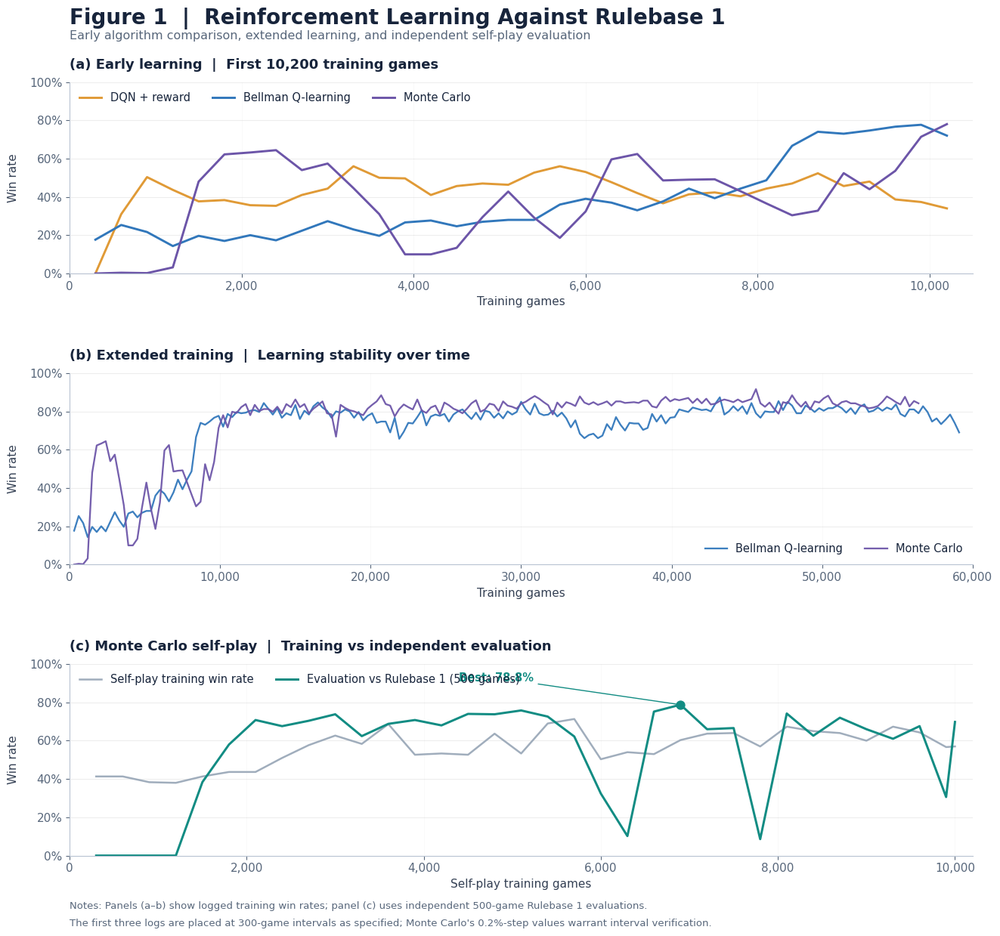
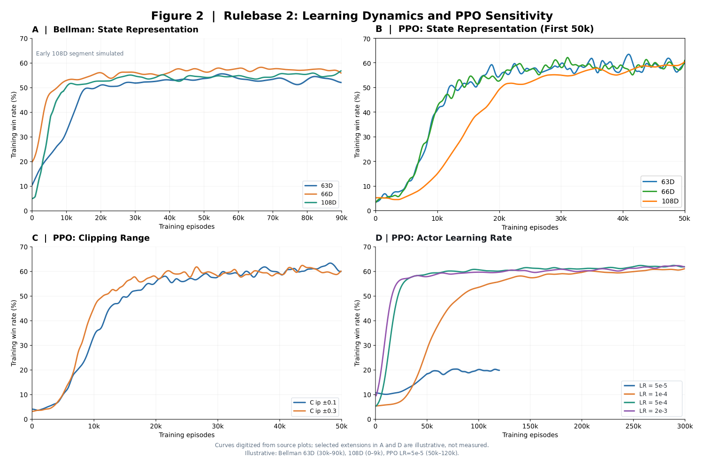
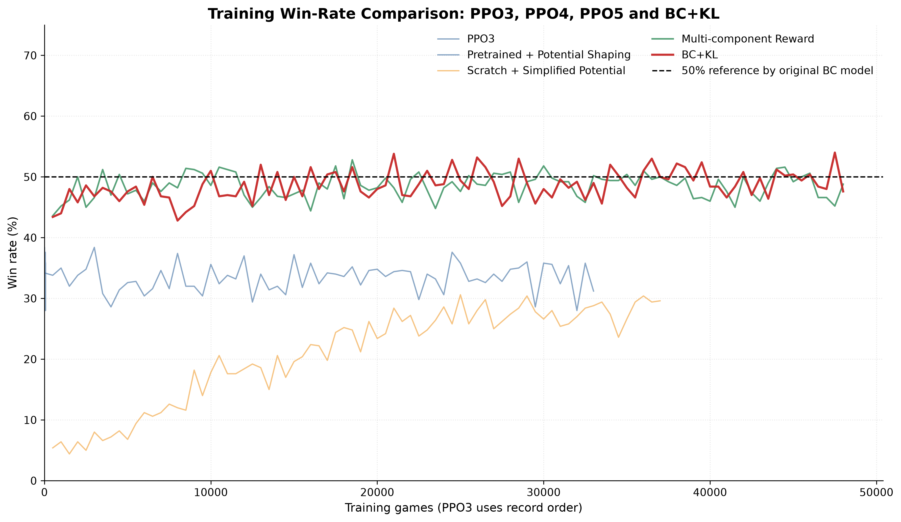

## Overview

A from-scratch exploration of how to effectively train a competitive Dou Dizhu agent. Starting with reinforcement learning from basic baselines, the project progressively explores expert-guided training, leveraging strong open-source agents such as DouZero as behavioral references to improve policy learning and overcome the limitations of training from scratch.

## Core Components

- **Custom Game Environment:** Built a Dou Dizhu environment with efficient legal-action generation through card-pattern matching, significantly improving simulation throughput.
- **Reinforcement Learning:** Explored and compared different training approaches, with iterative improvements to reward design, state representation, and policy optimization.
- **Expert-Guided Learning:** Incorporated strong pretrained agents such as DouZero as expert references, exploring ways to combine expert knowledge with reinforcement learning.
- **DouZero Integration:** Developed an adapter interface connecting the custom game environment with DouZero, enabling pretrained DouZero agents to participate in games while preserving the original agent's decision-making behavior and playing strength as closely as possible.
- **Benchmark & Evaluation:** Developed progressively stronger rule-based benchmarks and a fixed opponent pool to evaluate policy improvements and identify training limitations.

## Training Methodology

### 1. Reinforcement Learning from Scratch
Established initial training baselines using DQN, Monte Carlo methods, and PPO. Experimented with reward design, state representation, and temporal credit assignment to improve learning performance.

### 2. Expert-Guided Policy Learning
Introduced strong pretrained agents such as DouZero as sources of expert demonstrations. Explored combining expert-guided policy learning with reinforcement learning to overcome the limitations of training against weaker or overly strong opponents.

### 3. Opponent Pool and Policy Selection
Developed a fixed opponent pool consisting of diverse strategies, including DouZero and officially released variants from the DouZero team. Introduced repeated evaluation and tournament-based model selection to encourage consistent policy improvement.

## Experimental Results

### 4.1 Reinforcement Learning Against Rulebase 1

Initial experiments focused on training agents from scratch against a simple rule-based opponent that consistently selected the smallest legal action(91% winning percentage vs random choice agent).

DQN, Bellman-based Q-learning, and Monte Carlo methods were compared to investigate their learning behavior and training stability so as to determine suitable training methods. Monte Carlo self-play was subsequently introduced to examine whether agents could improve through interaction with copies of their own policy.

**Figure 1 — Reinforcement Learning Experiments Against Rulebase 1**

**Key Findings**

- **Learning effectiveness:** Bellman-based Q-learning and Monte Carlo methods achieved substantial improvements over the initial reward-based DQN baseline.
- **Training instability:** Monte Carlo exhibited significant performance fluctuations, even after achieving high win rates.
- **Self-play evaluation:** Monte Carlo self-play achieved a peak evaluation win rate of **78.8%** against Rulebase 1, but subsequent checkpoints showed substantial performance degradation.
- **Model selection:** These experiments highlighted the importance of independent evaluation and best-checkpoint selection rather than relying on the final trained model.

### 4.2 Further Reinforcement Learning Experiment Against Rulebase 2

Following the initial experiments, Bellman-based DQN achieved **80.1% win rate against Rulebase 1**, highlighting the importance of temporal credit assignment. Double DQN was subsequently explored to improve training stability.

However, improvements against a simple opponent eventually became less informative. A stronger benchmark, **Rulebase 2**, was introduced to evaluate whether the learned policies could handle more challenging decision-making scenarios. This opponent achieved approximately 99% win rate against random play.

**Initial Evaluation Against Rulebase 2**

| Method | Win Rate |
|---|---:|
| Bellman-based DQN | 52.5% |
| Monte Carlo | 33.5% |
| Monte Carlo Self-play | 48.4% |

These results revealed substantial differences between the learning approaches. Bellman-based DQN demonstrated stronger initial performance, while Monte Carlo methods struggled to achieve comparable results.

**Further Training and Optimization**
Training directly against Rulebase 2 improved Monte Carlo performance to approximately 47%, while Bellman-based DQN initially reached around 55%. Subsequent improvements to state representation increased Bellman-based DQN performance from 56.2% to 61.2%.

Motivated by the training instability observed in Monte Carlo and DQN experiments, PPO was introduced as an alternative policy optimization approach to investigate more stable learning behavior. Initial experiments achieved approximately 58% win rate, with later configurations reaching around 60% and exhibiting relatively stable learning behavior.

**Figure 2 — State Representation and PPO Hyperparameter Experiments**

]

**Key Findings**

- **Bellman-based learning:** Incorporating future rewards substantially improved performance against the initial benchmark. Bellman-based DQN also demonstrated strong results against Rulebase 2, with further gains from state representation improvements.
- **Monte Carlo limitations:** Despite additional training and self-play experiments, Monte Carlo methods generally underperformed the stronger Bellman-based configurations.
- **PPO training stability:** PPO achieved competitive performance with relatively stable training behavior. Experiments with different learning rates, clipping ranges, and state representations produced limited additional improvements.
- **Diminishing returns:** Repeated tuning eventually produced smaller performance gains, motivating a transition toward stronger opponents and alternative training approaches.

**Algorithm Selection**

Based on these experiments, **Bellman-based DQN and PPO were selected for further investigation**. Bellman-based DQN demonstrated strong performance improvements, particularly through state representation refinement, while PPO offered a relatively stable policy optimization framework.

The next stage introduced DouZero as a substantially stronger opponent. Initial evaluation of the best PPO agent achieved only **26.0% win rate**, exposing a significant gap between performance against rule-based opponents and more competitive trained agents.

This motivated subsequent experiments with expert demonstrations, behavioral cloning, and reinforcement learning guided by pretrained policies, DouZero. 

**Figure 3. Training Dynamics of Bellman-based DQN and PPO Against the Official Pretrained DouZero Agent.**

！[figure3](image/figure3.png)

DouZero is a widely recognized open-source Dou Dizhu AI, introduced at ICML 2021. It achieved state-of-the-art performance among contemporary Dou Dizhu agents, ranking first on the Botzone leaderboard among 344 AI agents, making it a strong benchmark for evaluating learned policies.

Both agents were trained against the official pretrained DouZero model through a custom adapter interface. Bellman-based DQN exhibited substantial fluctuations throughout approximately 300,000 training episodes, without achieving sustained improvement. In contrast, PPO demonstrated a more progressive learning trajectory, reaching a relatively stable training win rate of approximately 30–35% within 150,000 episodes.

These observations motivated further investigation into expert-guided policy learning, particularly the integration of Behavioral Cloning (BC) with PPO.

**Figure4. Behavior Cloning from DouZero**

As an initial attempt at expert-guided learning, Behavior Cloning (BC) was introduced using gameplay data generated by the pre-trained DouZero agent.

Figure4 showed that BC substantially improved performance against the previous rule-based benchmark, demonstrating the value of expert demonstrations for policy initialization.

**Key Findings**

- **Effectiveness of expert demonstrations:** BC significantly improved performance against the previous rule-based benchmark, showing that expert behavior provides a useful learning signal.
- **Diminishing returns from additional training:** Increasing training iterations improved performance, but the marginal gains became progressively smaller. For example, with 100k expert games, increasing training from 30 to 200 iterations improved the win rate against DouZero from 39% to 48%.
- **Impact of dataset size:** Increasing the expert dataset from 100k to 500k games further improved the win rate from 48% to 51% under the same 200-iteration configuration.

These experiments established BC as a useful initialization approach for subsequent reinforcement learning. However, the diminishing returns from simply increasing the dataset size or training iterations motivated further investigation into combining expert-guided learning with policy optimization.

**Figure 5**

### 3.2 Combining Behavior Cloning with Reinforcement Learning

Although Behavior Cloning provided a strong policy initialization, simply increasing the amount of expert data or training iterations led to diminishing returns. This motivated further exploration of combining expert-guided learning with reinforcement learning.

Based on the previous BC experiments, the subsequent BC+RL experiments used a policy pretrained on **500,000 expert games for 200 epochs**, which provided a stronger initialization for further reinforcement learning.

Several BC+RL configurations were investigated, using PPO as the policy optimization framework and exploring different ways to incorporate the pretrained BC policy.

**Figure 5 — Comparison of BC-guided Reinforcement Learning Strategies**

]

**Key Findings**

- **Limitations of unconstrained policy optimization:** Direct PPO updates could cause the policy to deviate from the expert behavior learned through BC, potentially weakening previously acquired decision-making capabilities.
- **Effectiveness of KL regularization:** Introducing a KL constraint between the updated policy and the BC reference policy helped preserve expert knowledge while allowing further policy optimization.
- **Improved training behavior:** Compared with alternative BC+RL configurations, the KL-constrained approach demonstrated the most effective improvement in the experiments.
- **Expert knowledge retention:** KL regularization provided a balance between learning from reinforcement signals and retaining the useful behavior acquired through expert demonstrations.

These results suggested that maintaining a reference to the BC policy was important for effective policy optimization against strong opponents. The final BC+PPO+KL configuration achieved a win rate of **55% against the official pre-trained DouZero agent**, improving upon the initial pure PPO baseline of 26% and original BC model of 51%.

### 3.3 Historical Opponent Pool and Training Strategy

To further improve policy robustness, an initial self-play-based historical model pool was investigated. The approach first generated five models using PPO+BC+KL, then trained them through self-play. A model trained in the landlord position was selected to play against two self-play models, and high-performing checkpoints were retained for subsequent training in the farmer position.

However, this approach revealed a role-specific policy mismatch. Models trained primarily as landlords did not necessarily learn effective farmer strategies when reused as historical opponents. This differed from DouZero, which provides separate specialized models for landlord and farmer positions. As a result, the self-play-based pool failed to provide consistently useful training signals.

To address this issue, the training framework was changed to use a fixed opponent pool with a larger number of sampled games. Three additional opponents based on DouZero were introduced: **SL**, **ADP**, and **WP**. During training, the agent played as the landlord against randomly sampled farmer opponents from the fixed pool. Each training round consisted of 5,000 games using PPO+KL+RL, with evaluation every 500 batches. The best checkpoint was retained based on evaluation performance.

The candidate checkpoint was then evaluated against each of the four opponents over 1,000 games. Its average win rate was compared with the lowest-performing model in the existing five-model best pool. A performance improvement of at least **0.5 percentage points** was used as the initial replacement threshold. The candidate would replace the weakest model if this criterion was met, and a model from the updated pool would then be sampled for the next training round.

**Opponent Pool Evaluation**

| Opponent | Win Rate | Description |
|---|---:|---|
| DouZero | 55% | Official pretrained DouZero agent |
| ADP | 53% | Conservative strategy focused on average score difference |
| WP | 44% | Strategy focused on winning percentage |
| SL | 65% | Supervised model based on human decisions |

Increasing the number of evaluation games to reduce random variance, and extending each training round to more than 20,000 games. The longer training schedule was motivated by observations that the KL-constrained BC+PPO training curve often reached its peak after approximately 20,000 games.

The updated opponent pool achieved the following evaluation results:

| Opponent | Win Rate |
|---|---:|
| DouZero | 56% |
| ADP | 54% |
| WP | 44% |
| SL | 65% |

details are shown by figure6:
]

Despite these adjustments, the new historical pool did not consistently produce models that outperformed the original checkpoints. Although opponent-pool updates provided marginal improvements, the overall gains remained limited. These experiments suggest that the effectiveness of historical opponent pools is fundamentally constrained by the underlying policy optimization method. Building a more diverse opponent pool alone is insufficient; **how to train a stronger Dou Dizhu policy effectively remains the central challenge.**

